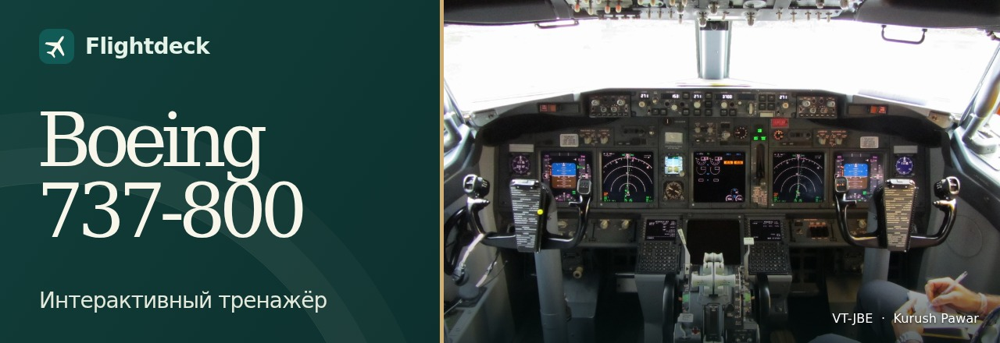
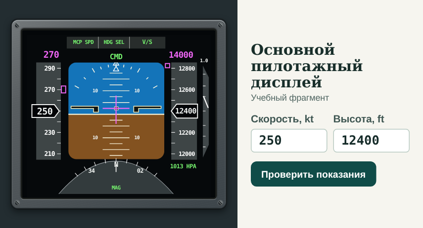
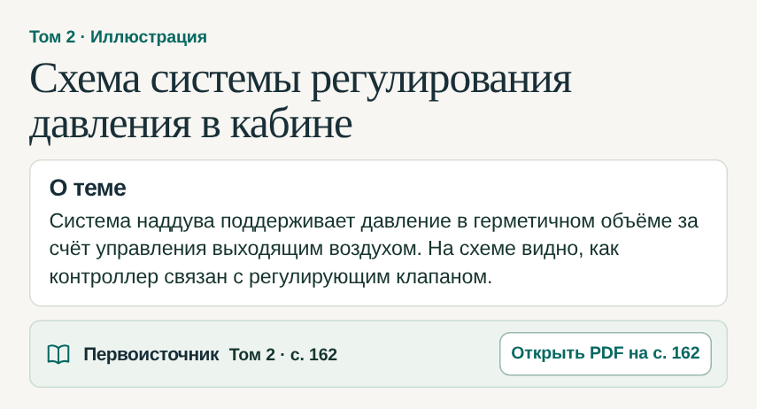

<p align="center">
  
</p>

<p align="center">
  <a href="https://isarnavskiy.github.io/737-fcom-trainer/"></a>
</p>

<p align="center">
  Найдите прибор в кабине, попробуйте его в работе и сверьтесь с руководством Boeing 737.<br>
  На русском языке, в браузере компьютера или телефона. Установка и регистрация не нужны.
</p>

<p align="center">
  <a href="https://isarnavskiy.github.io/737-fcom-trainer/#theory"><b>Уроки</b></a> &nbsp;·&nbsp;
  <a href="https://isarnavskiy.github.io/737-fcom-trainer/#scenarios"><b>Сценарии</b></a> &nbsp;·&nbsp;
  <a href="https://isarnavskiy.github.io/737-fcom-trainer/#drill"><b>Наизусть</b></a> &nbsp;·&nbsp;
  <a href="https://isarnavskiy.github.io/737-fcom-trainer/#atlas"><b>Атлас FCOM</b></a> &nbsp;·&nbsp;
  <a href="https://isarnavskiy.github.io/737-fcom-trainer/#reference"><b>Первоисточники</b></a>
</p>

## Первое занятие в кабине

Начните с основного пилотажного дисплея командира. Найдите его на фотографии, прочитайте скорость по левой шкале и высоту по правой. После ответа тренажёр покажет разбор. Нажмите на первый снимок, чтобы начать это упражнение. Второй откроет пример из атласа — схему регулирования давления в кабине.

<p align="center">
  <a href="https://isarnavskiy.github.io/737-fcom-trainer/#cockpit/pfd-read"></a>
  <a href="https://isarnavskiy.github.io/737-fcom-trainer/#topic/v2-0159"></a>
</p>

[Считать скорость и высоту](https://isarnavskiy.github.io/737-fcom-trainer/#cockpit/pfd-read) · [Выставить курс на MCP](https://isarnavskiy.github.io/737-fcom-trainer/#cockpit/mcp-heading) · [Измерить частоту генератора](https://isarnavskiy.github.io/737-fcom-trainer/#cockpit/electric-meter)

## Выберите, чем заняться

| Раздел | Что внутри |
| --- | --- |
| [Кабина](https://isarnavskiy.github.io/737-fcom-trainer/#cockpit) | 13 приборов и панелей на двух фотографиях. Каждый можно рассмотреть крупнее и попробовать в отдельном задании. |
| [Теория](https://isarnavskiy.github.io/737-fcom-trainer/#theory) | 61 урок по ограничениям, процедурам, характеристикам и системам самолёта. Из урока можно перейти к сценарию и страницам руководства. |
| [Сценарии](https://isarnavskiy.github.io/737-fcom-trainer/#scenarios) | 61 ситуация и 183 решения с объяснениями. [Журнал прогресса](https://isarnavskiy.github.io/737-fcom-trainer/#progress) запоминает результаты и темы для повторения на этом устройстве. |
| [Наизусть](https://isarnavskiy.github.io/737-fcom-trainer/#drill) | 79 карточек с интервальным повторением: ограничения и числа, memory items QRH, манёвры (сваливание, сдвиг ветра, PULL UP, TCAS RA, прерванный взлёт) и сокращения. Шаги действий по памяти можно собирать по порядку. Для каждой колоды есть шпаргалка для печати. |
| [Контрольный тест](https://isarnavskiy.github.io/737-fcom-trainer/#exam) | 10, 20 или 30 случайных вопросов из всех сценариев или одного модуля. Ответы проверяются в конце, как на проверке. Зачёт от 75 %, разбор со ссылками на уроки и страницы FCOM. |
| [Атлас FCOM](https://isarnavskiy.github.io/737-fcom-trainer/#atlas) | Поиск по 2 403 тематическим закладкам двух томов. В карточках есть пояснения, номера страниц и связанные занятия. Для разделов и подразделов подготовлены 186 авторских заметок. |

### Заниматься без интернета

Скачайте файл и откройте его в браузере. Кабина, уроки, атлас и документ FAA уже внутри. На телефоне можно открыть сайт по QR-коду из меню «Поделиться».

**[Скачать автономный тренажёр · HTML](https://github.com/isarnavskiy/737-fcom-trainer/releases/latest/download/flightdeck-737.html)** · [Все выпуски](https://github.com/isarnavskiy/737-fcom-trainer/releases)

## Документы и фотографии

В основе занятий русский перевод *737 Flight Crew Operations Manual*, D6-27370-8AS-UTR. В разделе «Первоисточники» можно выбрать оба PDF сразу. Браузер проверит издание и запомнит его на устройстве. После этого ссылка из урока или кабины откроет нужную страницу.

| Том | Содержание | Перейти |
| --- | --- | --- |
| **Том 1** · 1 484 страницы | Ограничения, нормальные и дополнительные процедуры, предполётные и полётные характеристики | [Оглавление](https://isarnavskiy.github.io/737-fcom-trainer/#atlas/1) · [Открыть PDF](https://isarnavskiy.github.io/737-fcom-trainer/#reference/1/1) |
| **Том 2** · 1 400 страниц | Устройство самолёта и работа систем, главы 1–15 | [Оглавление](https://isarnavskiy.github.io/737-fcom-trainer/#atlas/2) · [Открыть PDF](https://isarnavskiy.github.io/737-fcom-trainer/#reference/2/1) |

- **Boeing** предоставляет англоязычный FCOM по лицензии. В русском издании указан перевод с помощью ИИ и приоритет английского оригинала. [Руководства Boeing](https://services.boeing.com/training-solutions/flight-training/licensed-manuals) · [MyBoeingFleet](https://services.boeing.com/operations/myboeingfleet-portal)
- **FAA AC 120-71B** описывает стандартные процедуры и обязанности пилота, контролирующего полёт. [Читать PDF](docs/faa-ac-120-71b.pdf) · [Страница FAA](https://www.faa.gov/regulations_policies/advisory_circulars/index.cfm/go/document.information/documentID/1030486)
- **Фотографии кабины** сняли Kurush Pawar и Artem Katranzhi. На обложке — Boeing 737-800 авиакомпании Jet Airways, борт VT-JBE. [Оригиналы и лицензия CC BY-SA 2.0](PHOTO-CREDITS.md)

Значения из AFM, QRH и табличек в разделе «Наизусть» приведены для типового 737-800 с двигателями CFM56-7B. Они помечены в карточках, их нужно сверить с документами своего эксплуатанта.

Тренажёр предназначен для самостоятельных занятий и домашнего симулятора. Для лётной работы применяют действующую утверждённую документацию эксплуатанта.

<details>
<summary><b>Запуск и сборка из исходного кода</b></summary>

Запустите локальный сервер из каталога репозитория и откройте [localhost:8000](http://localhost:8000).

```sh
python3 -m http.server 8000
```

Чтобы собрать автономный HTML с фотографиями, атласом и документом FAA, выполните команду и откройте полученный файл в браузере.

```sh
python3 scripts/build-offline.py flightdeck-737.html
```

</details>
