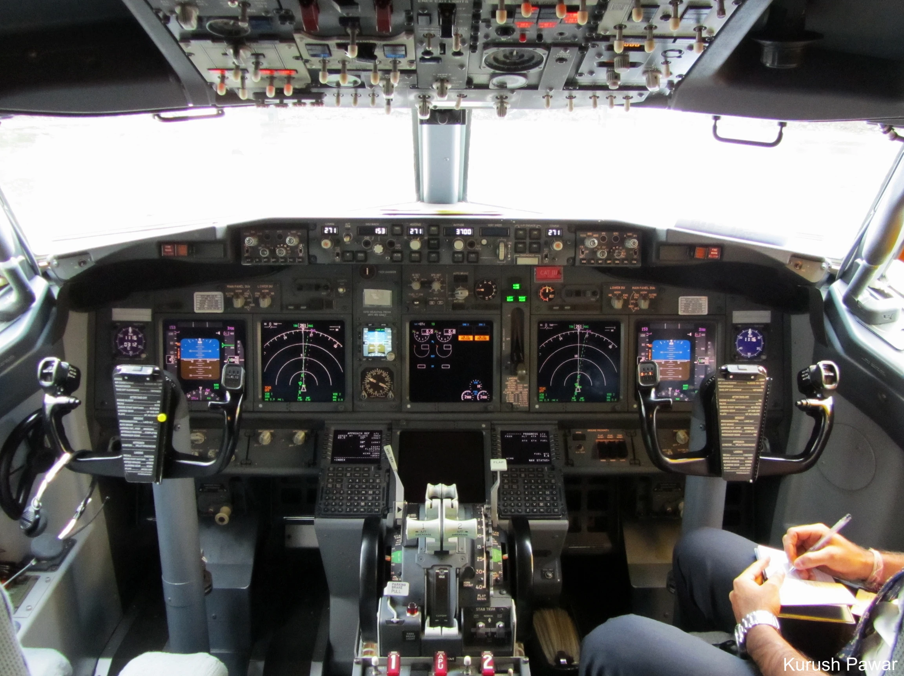

# Flightdeck / 737 · Интерактивная кабина

**[Открыть тренажёр Boeing 737-800](https://isarnavskiy.github.io/737-fcom-trainer/)**

Ссылка сразу открывает кабину в браузере на компьютере или телефоне. Регистрация, установка и PDF для занятий не нужны.

[](https://isarnavskiy.github.io/737-fcom-trainer/)

Фото Kurush Pawar, CC BY-SA 2.0. [Источники фотографий и лицензии](PHOTO-CREDITS.md)

## Практика в кабине

1. Выберите переднюю приборную доску или верхнюю панель. Нажмите на прибор, чтобы рассмотреть его крупнее и узнать назначение.
2. Перейдите к заданиям. Сначала найдите нужное место на фотографии. Затем выполните действие на увеличенной учебной панели.
3. Проверьте разбор и перейдите к следующему упражнению. Тренажёр запоминает текущий шаг и результаты в этом браузере.

В упражнениях вы считываете скорость и высоту с PFD, меняете масштаб навигационной карты, поворачиваете селектор курса MCP, сравниваете параметры двигателей и читаете электрические показания на верхней панели. Учебные показания задаёт сценарий. Расположение оборудования можно сверить с исходным снимком в каждом упражнении.

[Начать задание на PFD](https://isarnavskiy.github.io/737-fcom-trainer/#cockpit/pfd-read) · [Перейти к электроизмерительной панели](https://isarnavskiy.github.io/737-fcom-trainer/#cockpit/electric-meter)

## Другие способы открыть

- [Теория по FCOM](https://isarnavskiy.github.io/737-fcom-trainer/#theory) и [практические сценарии курса](https://isarnavskiy.github.io/737-fcom-trainer/#scenarios). В курсе 36 уроков и 108 решений с разбором.
- [Скачать автономную версию одним HTML-файлом](https://github.com/isarnavskiy/737-fcom-trainer/releases/latest/download/flightdeck-737.html). Сохраните файл и откройте его в браузере.
- [Зеркало тренажёра](https://flightdeck-fcom-737-ru.metriccastle2.chatgpt.site). Для передачи ссылки на телефон в верхней панели сайта доступен QR-код.

## Что внутри

| Модуль | Уроки | Примеры практики |
| --- | ---: | --- |
| Ограничения | 3 | Сравнить показания высотомеров между собой и с превышением аэродрома, прочитать условия ограничения |
| Нормальные процедуры | 6 | Распределить обязанности PF и PM, найти расхождение в данных FMC, разобрать подготовку к снижению |
| Дополнительные процедуры | 6 | Разобраться в исходных данных для наддува, электропитания, связи, навигации и полёта в холодном воздухе |
| Лётные характеристики | 6 | Выбрать таблицу для нужного варианта самолёта и прочитать единицы времени, топлива, пути и массы |
| Системы самолёта | 15 | По одному уроку для каждой из 15 глав второго тома, от наружного освещения до предупреждений TCAS |

- **Теория.** Выберите тему в каталоге, изучите схему и нажмите на её элементы. В двух уроках есть отдельные интерактивные стенды для высотомеров и радиостанции.
- **Практика.** Выберите сценарий, изучите условия и показания, затем подтвердите ответ. Тренажёр объяснит решение. Вы можете вернуться к теории и продолжить с того же шага.
- **Прогресс.** В журнале видны прочитанные уроки, последние результаты и темы, в которых были ошибки. Состояние сохраняется в браузере на текущем устройстве. В журнале отдельно видны результаты заданий в кабине.
- **Справочник FCOM.** Добавьте исходные PDF в одноимённый раздел, чтобы открывать цитируемые страницы из уроков. Браузер сверяет контрольную сумму издания и хранит файл локально. Для этой функции используйте HTTPS или localhost.

## Материалы

Курс основан на предоставленном русском переводе **737 Flight Crew Operations Manual**, D6-27370-8AS-UTR. В томе 1 — 1484 страницы, в томе 2 — 1400. Номера в уроках соответствуют порядковым страницам PDF. Уроки и сценарии — тематическая выборка из руководства. Исходные PDF подключаются пользователем.

Материал предназначен для самостоятельного изучения и домашнего симулятора. В издании указано, что перевод выполнен с помощью ИИ. Для лётной работы применяются актуальные утверждённые документы эксплуатанта.

## Локальный запуск и сборка

Откройте `index.html` из распакованного архива исходников или запустите из корня репозитория `python -m http.server 8000` и перейдите на [localhost:8000](http://localhost:8000).

Чтобы собрать автономную версию с фотографиями, выполните:
```sh
python3 scripts/build-offline.py flightdeck-737.html
```
