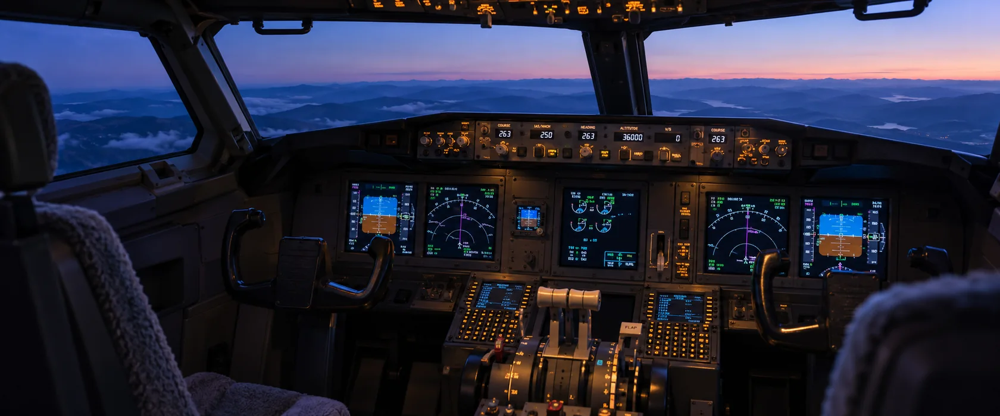

# Flightdeck / 737

Русскоязычный визуальный тренажёр по двум томам FCOM Boeing 737-800. В каждом из 36 занятий есть теория и отдельная учебная ситуация с тремя решениями. Тренажёр объясняет каждый ответ и сохраняет текущий шаг в браузере.



## Открыть тренажёр

[Открыть размещённый тренажёр](https://flightdeck-fcom-737-ru.metriccastle2.chatgpt.site) (доступ владельца).

Скачайте код репозитория как ZIP, распакуйте его и откройте `index.html` в современном браузере. Для теории и практики достаточно файлов из архива. На телефоне удобнее открыть размещённую версию сайта.

Для локального запуска через HTTP из каталога проекта выполните:

```sh
python -m http.server 8000
```

Откройте [localhost:8000](http://localhost:8000). Зависимости и сборка не требуются.

## Что внутри

| Модуль | Уроки | Примеры практики |
| --- | ---: | --- |
| Ограничения | 3 | Сравнить показания высотомеров между собой и с превышением аэродрома, прочитать условия ограничения |
| Нормальные процедуры | 6 | Распределить обязанности PF и PM, найти расхождение в данных FMC, разобрать подготовку к снижению |
| Дополнительные процедуры | 6 | Разобраться в исходных данных для наддува, электропитания, связи, навигации и полёта в холодном воздухе |
| Лётные характеристики | 6 | Выбрать таблицу для нужного варианта самолёта и прочитать единицы времени, топлива, пути и массы |
| Системы самолёта | 15 | По одному уроку для каждой из 15 глав второго тома, от наружного освещения до предупреждений TCAS |

- **Теория.** Выберите тему в каталоге, изучите схему и нажмите на её элементы. В двух уроках есть отдельные интерактивные стенды для высотомеров и радиостанции.
- **Практика.** Выберите сценарий, изучите условия и показания, затем подтвердите ответ. Тренажёр объяснит решение. Вы можете вернуться к теории и продолжить с того же шага.
- **Прогресс.** В журнале видны прочитанные уроки, последние результаты и темы, в которых были ошибки. Состояние сохраняется на текущем устройстве.
- **Справочник FCOM.** Добавьте исходные PDF в одноимённый раздел, чтобы открывать цитируемые страницы из уроков. Браузер сверяет контрольную сумму издания и хранит файл локально. Для этой функции используйте HTTPS или localhost.

## Материалы

Курс основан на предоставленном русском переводе **737 Flight Crew Operations Manual**, D6-27370-8AS-UTR. В томе 1 — 1484 страницы, в томе 2 — 1400. Номера в уроках соответствуют порядковым страницам PDF. Уроки и сценарии — тематическая выборка из руководства. Исходные PDF подключаются пользователем.

Материал предназначен для самостоятельного изучения и домашнего симулятора. В издании указано, что перевод выполнен с помощью ИИ. Для лётной работы применяются актуальные утверждённые документы эксплуатанта. Изображение кабины на главном экране — иллюстрация.
